<p align="center">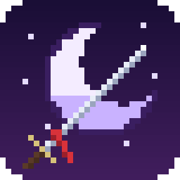</p>

<h1 align="center">Eclyra — Ayın Kuyusu</h1>
<p align="center">Kiri Köyü'nün altındaki 100 basamaklı Derinlik'e in, 10 Mühürdar'ı yen, Ay Tanrıçası Eclyra'yı uyandır.</p>
<p align="center"><a href="../../releases/latest"><b>⬇ Windows için indir (Setup.exe)</b></a></p>

<p align="center">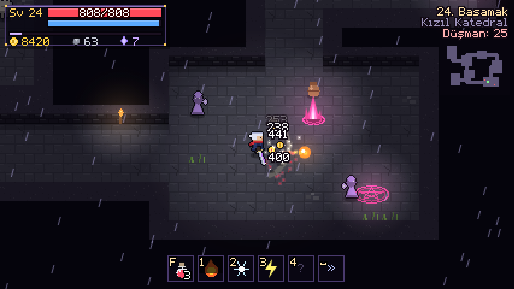</p>

## Ekran görüntüleri

| | |
|---|---|
| 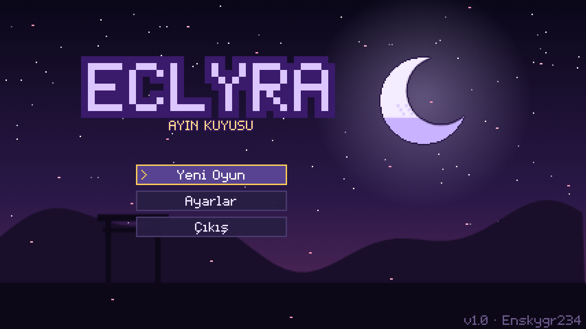 | 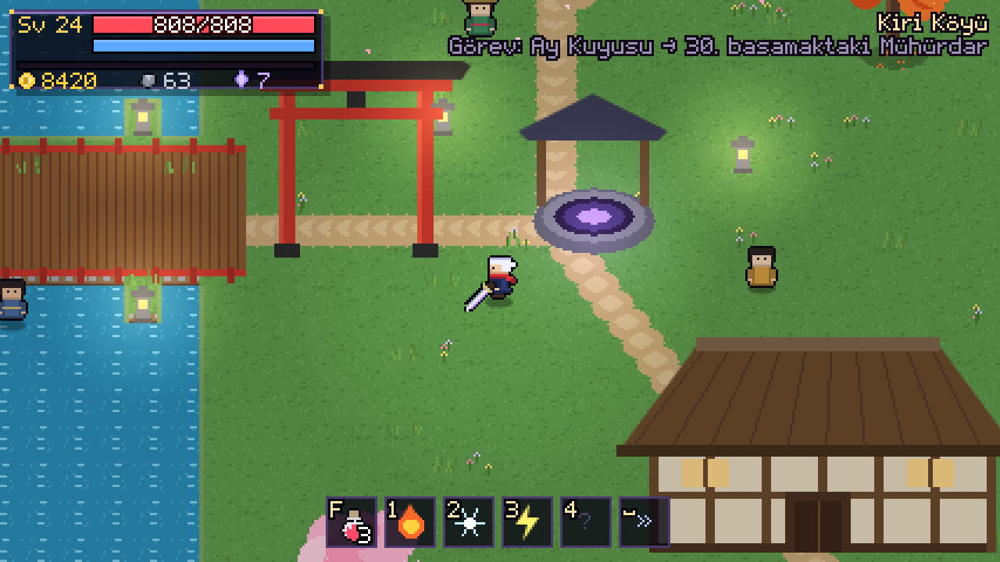 |
| Başlık ekranı | Kiri Köyü ve Ay Kuyusu |
| 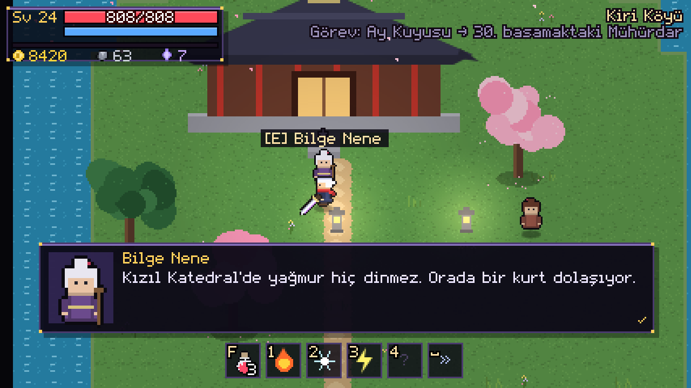 | 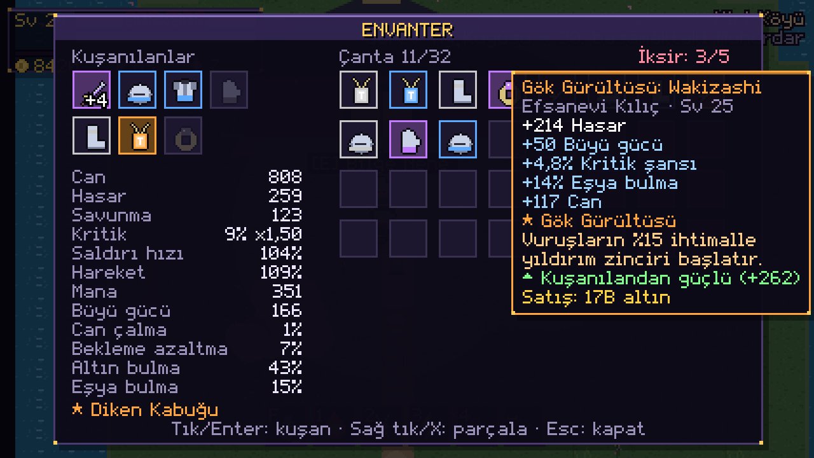 |
| Bilge Nene'nin hikâyesi | Envanter ve Efsanevi eşya |
| 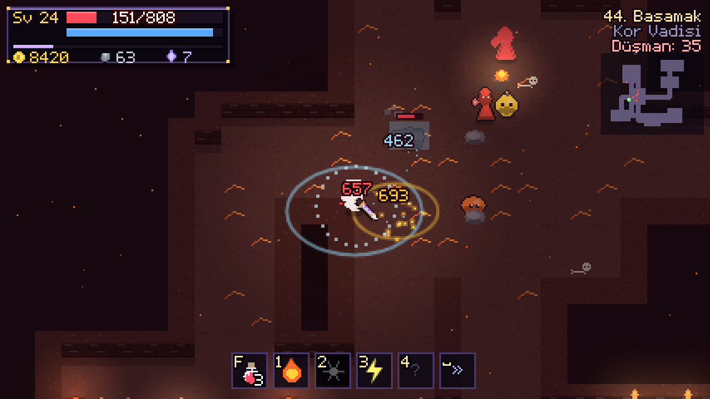 | 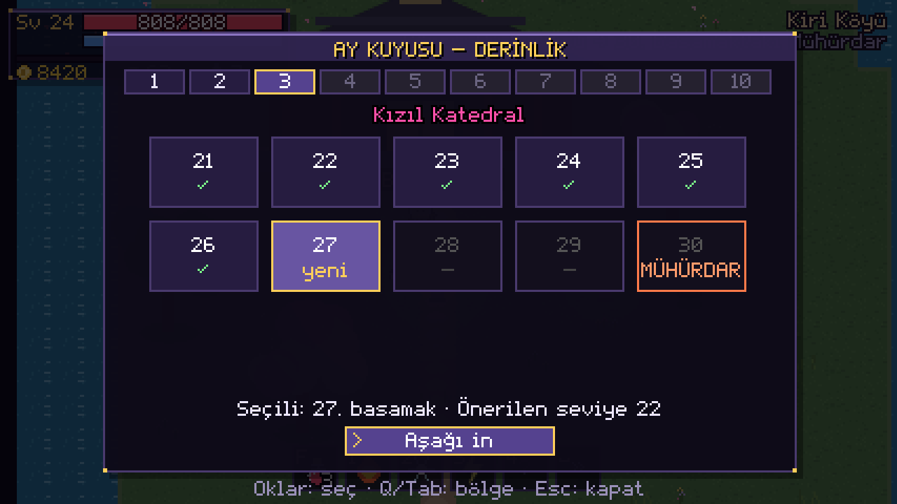 |
| Kor Vadisi'nde Buz Halkası | Ay Kuyusu: bölüm seçimi |

### Mühürdarlar

| | |
|---|---|
| 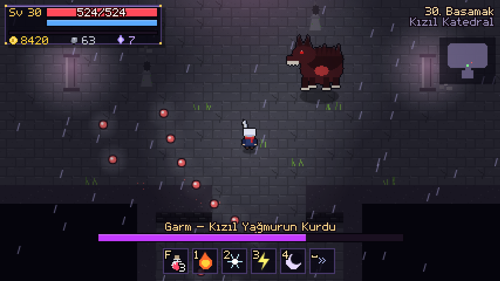 | 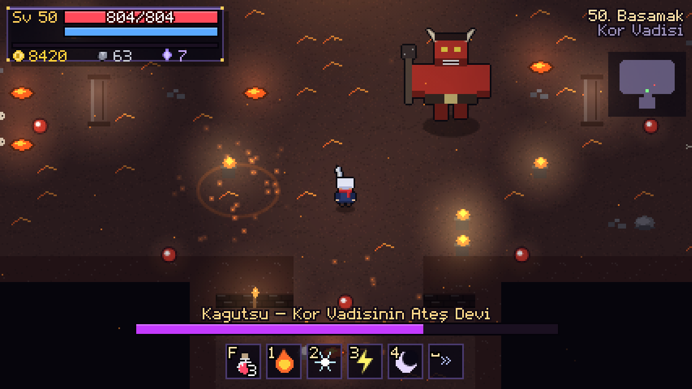 |
| Garm, Kızıl Yağmurun Kurdu (30) | Kagutsu, Kor Vadisinin Ateş Devi (50) |
| 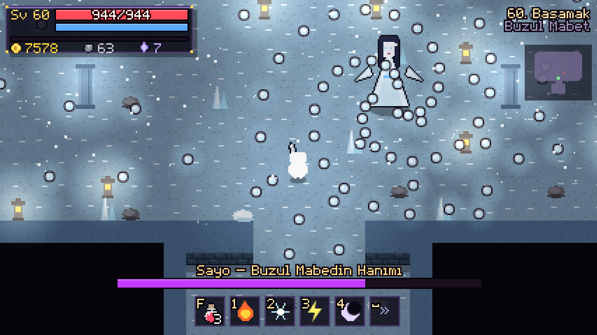 | 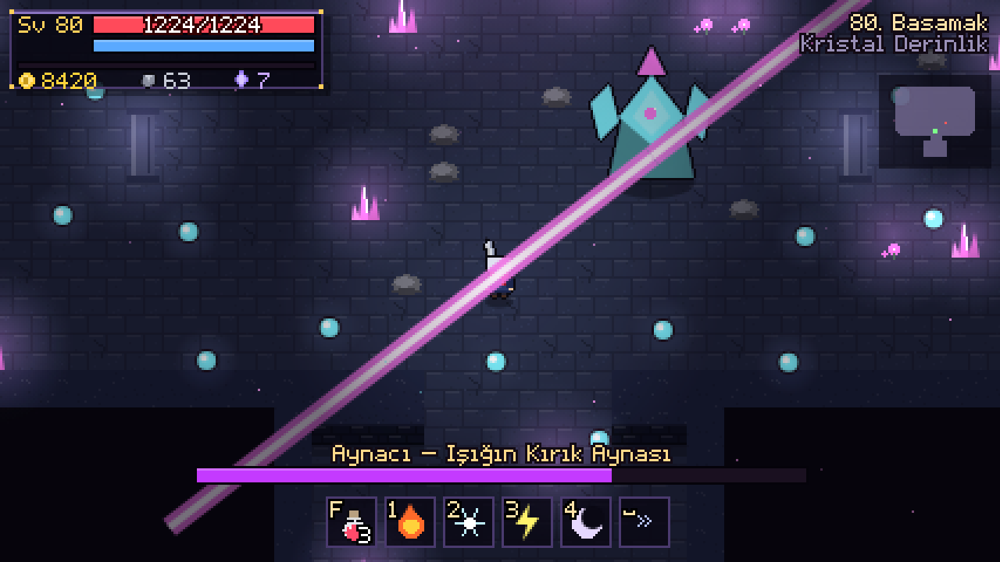 |
| Sayo, Buzul Mabedin Hanımı (60) | Aynacı, Işığın Kırık Aynası (80) |

---

## Hikâye

Yüz yıl önce Ay Tanrıçası Eclyra, köyün altındaki kuyuya **Hiçlik**'i mühürledi ve Derinlik'in her onuncu katına bir **Mühürdar** yerleştirdi. Bir gece yağmur kırmızı yağdı; Mühürdarlar Hiçlik'e yenik düştü. Sen **Aren**'sin, tapınağın son kılıç öğrencisi. Bilge Nene seni bekliyor.

## Oyun

- **100 basamak, 10 bölge**: Bambu Ormanı, Batık Tapınak, Kızıl Katedral, Mantar Mağarası, Kor Vadisi, Buzul Mabet, Kemik Bahçesi, Kristal Derinlik, Gölge Saray ve Eclyra'nın Kalbi. Her ziyarette harita yeniden üretilir.
- **Her 10. basamakta bir Mühürdar**: Buru, Mizuchi, Garm, Spor Ana, Kagutsu, Sayo, Kemik Dev, Aynacı, Kage ve Boş Kral. Hepsinin kendi saldırı düzeni var, canları yarıya inince öfkelenirler.
- **Kılıç ve büyü**: 3 vuruşluk kılıç kombosu, atılma, Ateş Topu, Buz Halkası, Yıldırım Zinciri ve Ay Kalkanı.
- **Eşya kasma**: 7 yuva, 4 nadirlik (Sıradan, Nadir, Destansı, Efsanevi), rastgele ek özellikler ve 8 farklı Efsanevi yetenek. Demirci'de +10'a kadar yükselt, gereksizleri parçalayıp demir topla.
- **Kiri Köyü güvenli bölge**: Bilge Nene (hikâye, büyü yükseltme), Demirci Tetsu (yükseltme, parçalama), Tüccar Mina (iksir, sandık, satış) ve Ay Kuyusu (açtığın her basamağa geri dönebilirsin).

## Kontroller

| Klavye ve fare | Oyun kolu | |
|---|---|---|
| WASD | Sol çubuk | Yürü |
| Fare | Sağ çubuk | Nişan al |
| Sol tık / J | RT ya da A | Kılıç |
| Boşluk / Shift | B ya da LT | Atıl |
| Sağ tık, 1, 2, 3, 4 | X, Y, RB | Büyüler |
| F | LB | İksir |
| E | A | Konuş / kullan |
| I / Tab | Select | Envanter |
| Esc | Start | Duraklat |
| F11 | | Tam ekran |

## Geliştirme

```bash
npm install
npm start
npm run dist   # dist/ klasörüne Eclyra-Setup.exe
```

Tüm çizimler, müzik ve sesler kodla üretilir; harici görsel ya da ses dosyası yoktur. `main` dalına yapılan her gönderimde GitHub Actions Windows kurulum paketini derler, oyunu açıp dener ve yeni Setup.exe'yi Releases'e yükler.
